# Архитектура `server/`

Статус: описание текущей реализации, 2026-10-23.

`server/` — ASP.NET Core 10-сервер чата: minimal API для чтения, SignalR-хаб `/hubs/chat`, состояние в памяти и одна последовательная очередь работ. Структура — Clean Architecture в четырёх проектах, `SignalRChat.Server` — composition root.

> Диаграммы выполнены в Mermaid. Они отображаются в GitHub и в Markdown Preview VS Code (`Cmd/Ctrl+Shift+V`); в обычном текстовом просмотре виден исходный код диаграмм.

## 0. Быстрая карта

| Вопрос | Ответ |
| --- | --- |
| Точка входа и сборка зависимостей | [Program.cs](../server/SignalRChat.Server/Program.cs) |
| Контракт хаба и обработка ошибок | [ChatHub.cs](../server/SignalRChat.Server/Hubs/ChatHub.cs) |
| Сценарии: мутация + группы + рассылка | [ChatRealtimeService.cs](../server/SignalRChat.Server/Realtime/ChatRealtimeService.cs) |
| Сериализация работ | [ChatWorkQueue.cs](../server/SignalRChat.Server/Queues/ChatWorkQueue.cs) |
| Бизнес-правила и валидация | [ChatService.cs](../server/SignalRChat.Application/Services/ChatService.cs) |
| Порт хранилища | [IChatStore.cs](../server/SignalRChat.Application/Abstractions/IChatStore.cs) |
| Состояние | [InMemoryChatStore.cs](../server/SignalRChat.Infrastructure/Persistence/InMemoryChatStore.cs) |
| DTO и маппинг | [ChatContracts.cs](../server/SignalRChat.Server/Contracts/ChatContracts.cs), [ContractMappings.cs](../server/SignalRChat.Server/Mapping/ContractMappings.cs) |

---

## 1. Проекты и зависимости

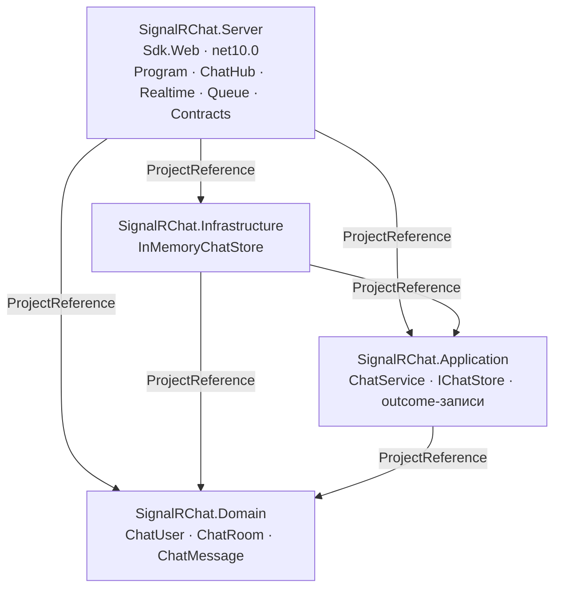

| Проект | Ссылается на | Роль |
| --- | --- | --- |
| `SignalRChat.Domain` | — | Чистые записи предметной области, без зависимостей |
| `SignalRChat.Application` | Domain | Use cases, валидация, порт `IChatStore`, outcome-записи |
| `SignalRChat.Infrastructure` | Application, Domain | In-memory реализация порта |
| `SignalRChat.Server` | все три | Хостинг, SignalR, очередь, DTO, OpenAPI, DI |

Зависимости направлены внутрь: `Server → Infrastructure/Application → Domain`. `Infrastructure` знает про `Application` только через порт.

---

## 2. Слои

### 2.1 Domain

[ChatEntities.cs](../server/SignalRChat.Domain/Entities/ChatEntities.cs) — три `record`:

- `ChatUser(Id, Name)`;
- `ChatRoom(Id, Name)`;
- `ChatMessage(Id, RoomId, AuthorId, AuthorName, Text, SentAt)`.

Домен анемичный: поведения и инвариантов в нём нет. Отдельно стоит знать, что `ChatRoom` в коде **не используется** — хранилище моделирует комнату собственным `RoomState` и проецирует её в `RoomSnapshot` из слоя Application.

### 2.2 Application

**Порт** [IChatStore.cs](../server/SignalRChat.Application/Abstractions/IChatStore.cs):

```csharp
public interface IChatStore
{
    IReadOnlyList<RoomSnapshot> GetRooms();
    RoomSnapshot? GetRoom(string roomId);
    ChatUser? GetUser(string connectionId);
    string? GetRoomId(string connectionId);
    ChatUser SetName(string connectionId, string name);
    JoinOutcome Join(string connectionId, string roomId, string userName);
    LeaveOutcome? Leave(string connectionId, string? expectedRoomId = null);
    void Forget(string connectionId);
    ChatMessage AddMessage(string connectionId, string roomId, string text);
    IReadOnlyList<ChatMessage> GetHistory(string roomId);
}
```

Рядом объявлены outcome-записи: `RoomSnapshot`, `JoinOutcome` (комната, пользователь, предыдущая комната), `LeaveOutcome`, `SendMessageOutcome` (сообщение и признак автоматического входа). Они нужны, чтобы хранилище вернуло всё, что сервер обязан разослать, не раскрывая внутреннее состояние.

**Use cases** [ChatService.cs](../server/SignalRChat.Application/Services/ChatService.cs):

- `GetRooms`, `GetHistory` — чтение;
- `JoinRoom`, `SetName`, `SendMessage`, `LeaveRoom`, `Disconnect` — запись;
- `RequireText` обрезает пробелы и бросает `ChatValidationException` на пустое значение;
- `SendMessage`: требует существующего пользователя, при отправке в другую комнату автоматически выполняет `Join`, затем `AddMessage`;
- `Disconnect`: `Leave` без ожидаемой комнаты + `Forget`.

`ChatService` синхронный и не знает ни про SignalR, ни про группы — это важно: его можно тестировать отдельно.

### 2.3 Infrastructure

[InMemoryChatStore.cs](../server/SignalRChat.Infrastructure/Persistence/InMemoryChatStore.cs) — реализация порта:

- все методы под одним `lock (sync)`;
- блокировка короткая: она не удерживается во время `await` (в хранилище вообще нет асинхронности), поэтому broadcast в очереди выполняется уже без блокировки;
- при старте создаёт комнаты `general` («Общий»), `random` («Флуд»), `support` («Поддержка»);
- любую неизвестную `roomId` создаёт на лету с `Name = roomId`;
- выдаёт наружу иммутабельные снимки (`RoomSnapshot`, массивы сообщений), а не внутренние коллекции.

### 2.4 Server

- [ChatHub.cs](../server/SignalRChat.Server/Hubs/ChatHub.cs) — тонкий адаптер: захватывает `Context.ConnectionId`, делегирует в `ChatRealtimeService`, превращает `ChatValidationException` в `HubException`. Сам хаб не хранит состояние; SignalR создаёт его на каждый вызов.
- [ChatRealtimeService.cs](../server/SignalRChat.Server/Realtime/ChatRealtimeService.cs) — «единица работы»: мутация состояния, изменение групп SignalR и рассылка событий. Работает через `IHubContext<ChatHub>`, поэтому может рассылать из фонового потока очереди.
- [ChatWorkQueue.cs](../server/SignalRChat.Server/Queues/ChatWorkQueue.cs) — `BackgroundService` + bounded `Channel`, один reader.
- `Contracts/` и `Mapping/` — DTO, повторяющие схемы OpenAPI, и преобразования из домена/Application.

---

## 3. Composition root и DI

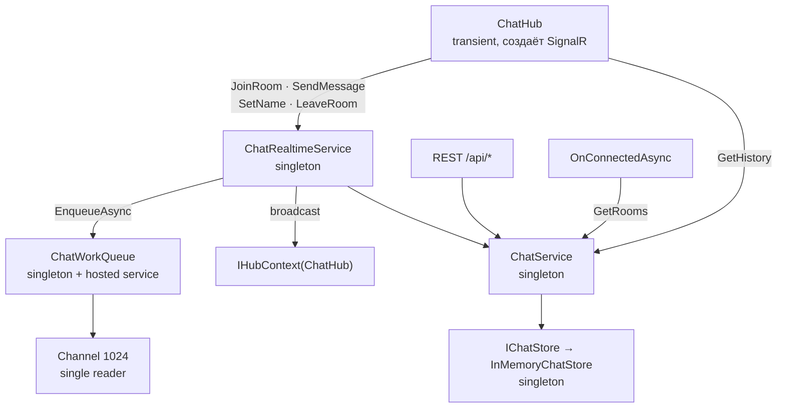

Регистрации в [Program.cs](../server/SignalRChat.Server/Program.cs):

| Регистрация | Lifetime | Зачем |
| --- | --- | --- |
| `AddSignalR().AddJsonProtocol(...)` | — | camelCase-поля, совместимые с `generated/rest.ts` |
| `IChatStore → InMemoryChatStore` | Singleton | Единственное хранилище состояния |
| `ChatService` | Singleton | Stateless use cases |
| `ChatWorkQueue` | Singleton | Очередь должна быть одна на процесс |
| `AddHostedService(sp => sp.GetRequiredService<ChatWorkQueue>())` | Hosted | Важно: именно фабрика, иначе хост создал бы **второй** экземпляр очереди, и работы уходили бы не в тот reader |
| `ChatRealtimeService` | Singleton | Единая точка входа для мутаций |
| `ChatHub` | Transient | Создаётся SignalR на вызов; все зависимости — синглтоны |

Пайплайн приложения:

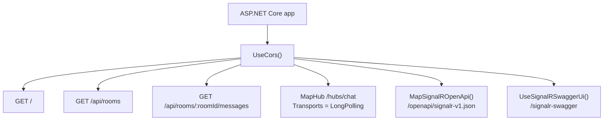

WebSockets и SSE отключены на уровне `MapHub`: сервер принимает только HTTP long polling.

---

## 4. Сквозной путь вызова

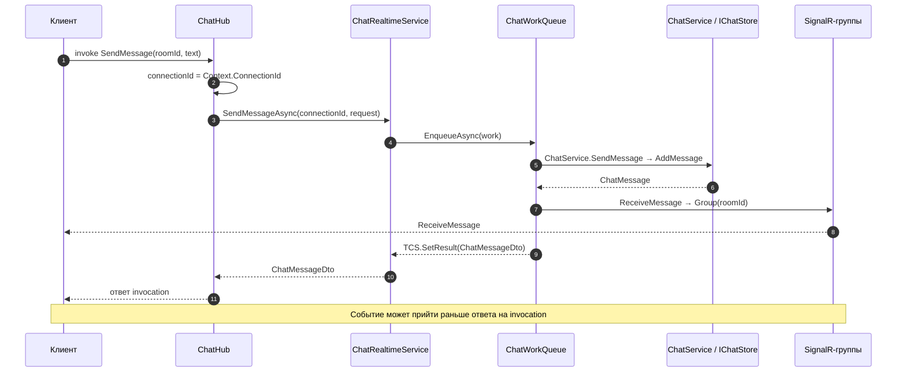

Ключевые свойства этого пути:

1. **Все записи сериализованы.** Join, SetName, SendMessage, LeaveRoom и Disconnect проходят через одну очередь, поэтому мутация состояния и её рассылка не перемешиваются между собой: клиент не увидит сообщение комнаты до `AddToGroup` нового участника или после `RemoveFromGroup` ушедшего.
2. **Чтения идут мимо очереди.** `GetHistory`, `GetRooms` и REST вызывают `ChatService` напрямую; консистентность чтения обеспечивает `lock` в хранилище.
3. **Рассылка выполняется до ответа на invocation.** События `UserJoined`/`ReceiveMessage`/`RoomUpdated` уходят на соединение раньше, чем завершается промис вызова. Клиент обязан корректно обрабатывать «событие пришло раньше ответа»; upsert по `id` это позволяет.
4. **Ошибка рассылки не откатывает мутацию.** Если `SendAsync` упадёт после `AddMessage`, сообщение уже в хранилище, а вызывающий получит ошибку. Outbox/ретраев нет.

---

## 5. Сценарии взаимодействия

| Метод хаба | Use case | Мутация | Рассылки |
| --- | --- | --- | --- |
| `SendMessage` | `ChatService.SendMessage` | `Join` (если другая комната) + `AddMessage` | `UserJoined`/`UserLeft`/`RoomUpdated` при auto-join; `ReceiveMessage` → группа |
| `JoinRoom` | `ChatService.JoinRoom` | `Join` | `UserLeft`/`RoomUpdated` для прошлой комнаты; `UserJoined`/`RoomUpdated` для новой |
| `SetName` | `ChatService.SetName` | `SetName` | `UserJoined` → группа (если пользователь в комнате) |
| `LeaveRoom` | `ChatService.LeaveRoom` | `Leave(expectedRoomId)` | `UserLeft` → группа; `RoomUpdated` → все |
| `GetHistory` | `ChatService.GetHistory` | — | — |
| `OnDisconnected` | `ChatService.Disconnect` | `Leave` + `Forget` | `UserLeft` → группа; `RoomUpdated` → все |

Общая карта методов и событий:

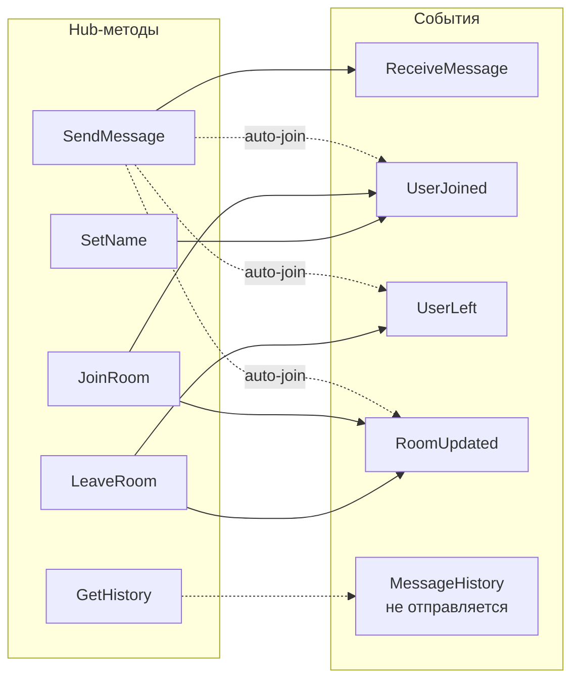

### 5.1 Подключение

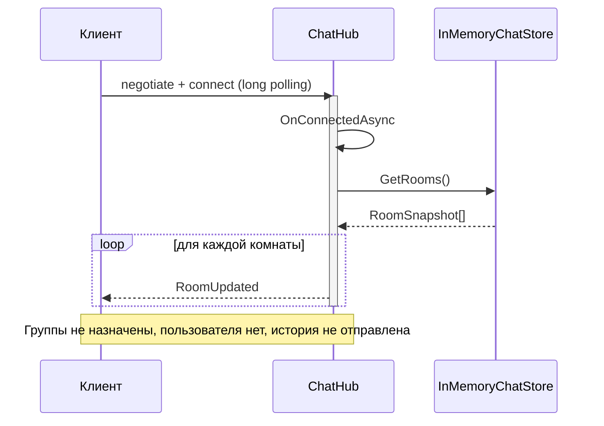

После подключения:

- соединение **не добавлено ни в одну группу**;
- у соединения ещё нет пользователя;
- история не отправляется — клиент сам вызывает `GetHistory`;
- стартовый список комнат приходит не отдельным методом, а серией `RoomUpdated` только вызывающему.

### 5.2 `JoinRoom`

```mermaid
sequenceDiagram
    autonumber
    participant C as Клиент
    participant H as ChatHub
    participant R as ChatRealtimeService
    participant Q as ChatWorkQueue
    participant S as ChatService / Store
    participant G as SignalR-группы

    C->>H: JoinRoom(roomId, userName)
    H->>R: JoinRoomAsync(connectionId, request)
    R->>Q: EnqueueAsync(work)
    Q->>S: JoinRoom → Join
    S-->>Q: JoinOutcome
    opt была предыдущая комната
        Q->>G: RemoveFromGroup(prev)
        Q->>G: UserLeft → Group(prev)
        Q->>G: RoomUpdated → Clients.All
    end
    Q->>G: AddToGroup(new)
    Q->>G: UserJoined → Group(new)
    Q->>G: RoomUpdated → Clients.All
    G-->>C: UserJoined / RoomUpdated
    Q-->>R: TCS.SetResult(JoinRoomResult)
    R-->>H: JoinRoomResultDto
    H-->>C: ответ invocation
    Note over C,G: События уходят до ответа; upsert по id обязателен
```

Нюансы:

- при переходе из комнаты в комнату `RemoveFromGroup` выполняется до `UserLeft`, поэтому уходящий не получает собственное `UserLeft`; `RoomUpdated` в `Clients.All` он получает, так как рассылка идёт вне групп;
- `AddToGroup` стоит до `UserJoined`, поэтому новый участник получает и своё событие входа;
- повторный `JoinRoom` в ту же комнату не даёт `PreviousRoom`, но обновляет имя пользователя из запроса;
- `RoomUpdated` уходит **всем** соединениям, включая тех, кто ни в одной комнате.

### 5.3 `SendMessage`

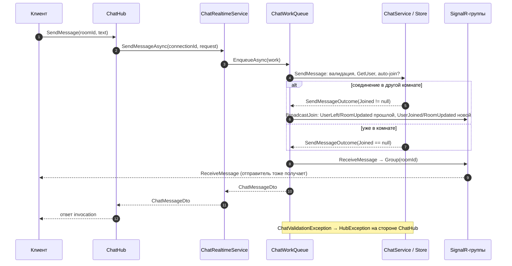

Следствия:

- отправитель получает собственное `ReceiveMessage`; дедупликация — по `id` сообщения;
- отправка в комнату, в которой соединение не состоит, автоматически переключает его туда, с корректным `UserLeft` для прошлой комнаты;
- без предварительного `SetName`/`JoinRoom` вызов завершается `HubException` с читаемым сообщением;
- `AddMessage` ставит `SentAt = DateTimeOffset.UtcNow`, `Id = Guid("N")`.

### 5.4 `SetName`

```mermaid
sequenceDiagram
    participant C as Клиент
    participant H as ChatHub
    participant R as ChatRealtimeService
    participant Q as ChatWorkQueue
    participant S as ChatService / Store
    participant G as SignalR-группы

    C->>H: SetName(name)
    H->>R: SetNameAsync(connectionId, request)
    R->>Q: EnqueueAsync(work)
    Q->>S: SetName + GetRoomId
    S-->>Q: (ChatUser, roomId)
    opt roomId != null
        Q->>G: UserJoined → Group(roomId)
        G-->>C: UserJoined (переиспользуется как UserUpdated)
    end
    Q-->>R: ChatUserDto
    R-->>H: ChatUserDto
    H-->>C: ответ invocation
    Note over Q,G: Вне комнаты рассылок нет; RoomUpdated не отправляется
```

Отдельного события `UserUpdated` в контракте нет, поэтому сервер шлёт `UserJoined`; клиент обновляет запись по `id`. `RoomUpdated` не отправляется — состав и размер комнаты не изменились. Вне комнаты событий нет вовсе.

### 5.5 `LeaveRoom`

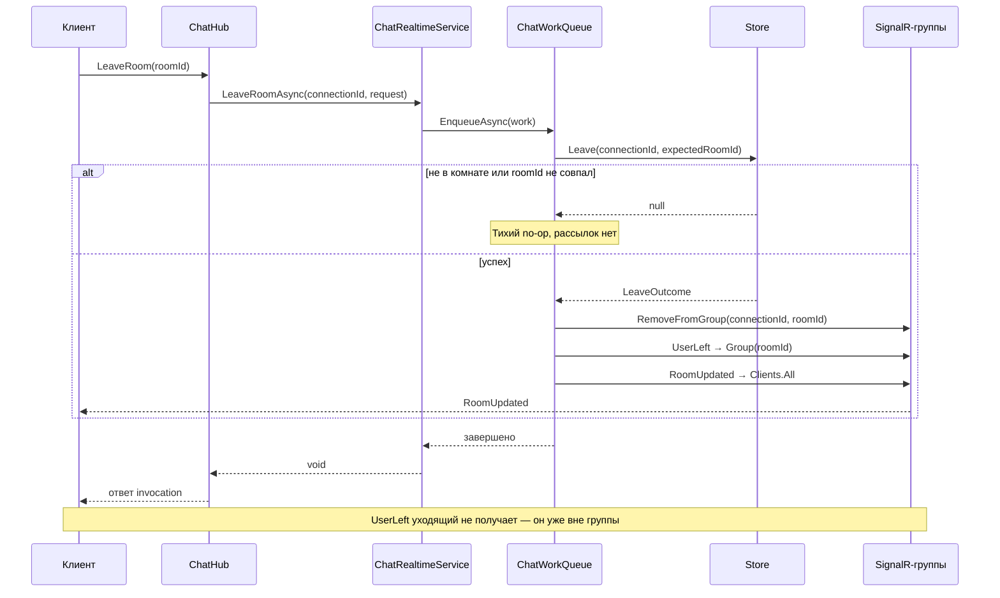

Запись пользователя в `usersByConnection` сохраняется — имя не теряется при выходе и пригодится при следующем входе. Удаляет её только `Forget` при отключении.

### 5.6 `Disconnect`

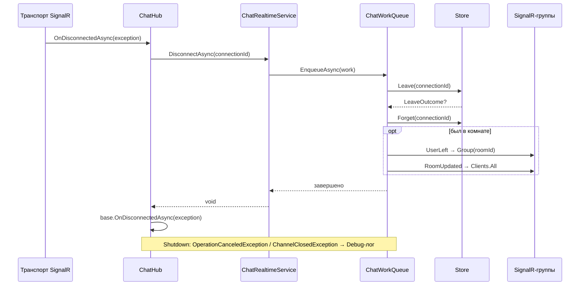

- `RemoveFromGroup` не вызывается: SignalR сам убирает соединение из групп.
- `OperationCanceledException` и `ChannelClosedException` перехватываются и логируются на уровне Debug — это штатная остановка сервера, `OnDisconnectedAsync` не должен падать.
- При shutdown работа может быть отменена, и `UserLeft` не уйдёт — сервер уже останавливается.

### 5.7 `GetHistory` и REST

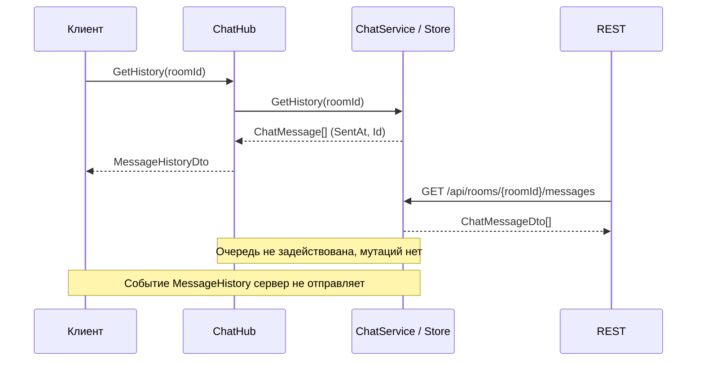

- сообщения сортируются по `SentAt`, затем по `Id`;
- неизвестная комната → пустой массив;
- `GET /api/rooms` и `GET /api/rooms/{roomId}/messages` идут тем же путём через `ChatService` и отдают `ChatRoomDto[]` / `ChatMessageDto[]`.

Важно: событие `MessageHistory` объявлено в `openapi/signalr.json`, но сервер его **никогда не отправляет**. История приходит только как ответ на `GetHistory`. Клиент в [use-room-history.ts](../apps/web/src/entities/message/api/use-room-history.ts) использует результат invoke, а подписка на событие в [use-message-sync.ts](../apps/web/src/entities/message/api/use-message-sync.ts) остаётся защитной и не срабатывает.

---

## 6. Модель состояния

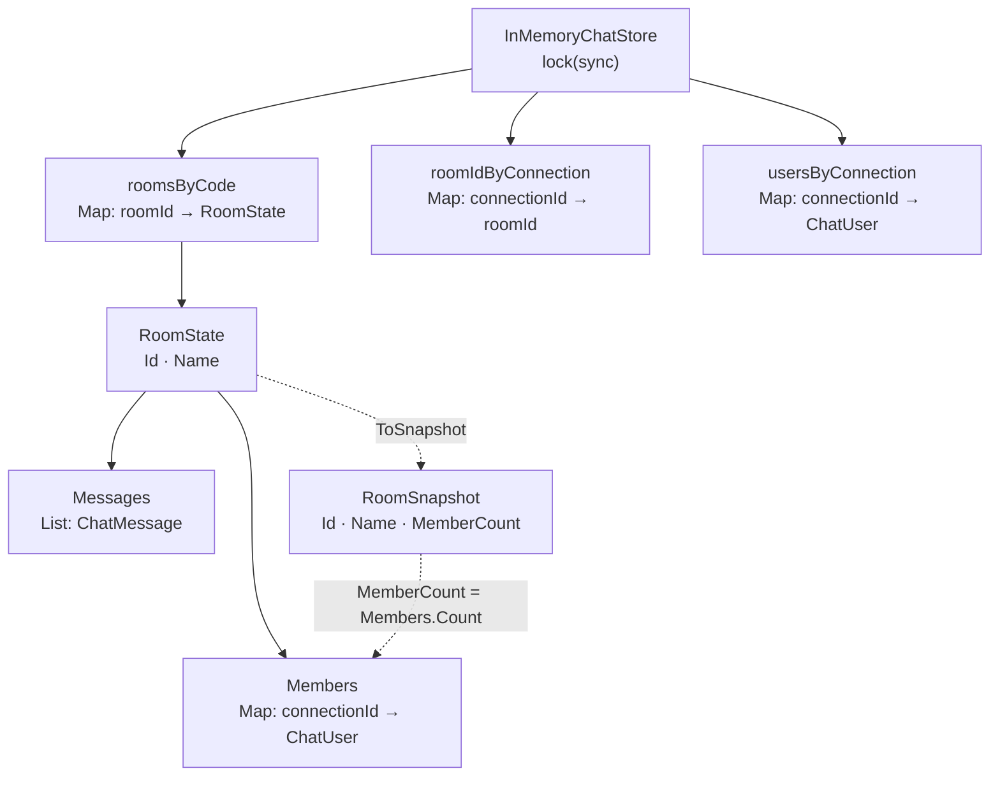

Сид-комнаты: `general` («Общий»), `random` («Флуд»), `support` («Поддержка»). Любая другая `roomId` создаётся на лету с `Name = roomId`.

Инварианты:

- `ChatUser.Id == connectionId` — идентичность пользователя привязана к соединению; реконнект даёт нового пользователя;
- соединение состоит максимум в одной комнате; `roomIdByConnection[conn] = room` эквивалентно `conn ∈ roomsByCode[room].Members`;
- `RoomSnapshot.MemberCount` вычисляется при проецировании как `Members.Count`;
- сообщение хранит снимок `AuthorId`/`AuthorName`: последующий `SetName` не переписывает историю;
- `Forget` удаляет только пользователя, не сообщения;
- все мутации возвращают наружу снимки, поэтому вызывающий код не может изменить состояние в обход `lock`.

Конкурентность:

| Поток | Что делает | Защита |
| --- | --- | --- |
| Reader очереди | Все мутации + рассылки | Сериализация очередью + `lock` |
| Запросы REST | Чтение комнат/истории | `lock` |
| `OnConnectedAsync` | Чтение списка комнат | `lock` |
| `GetHistory` из хаба | Чтение истории | `lock` |

Очередь даёт глобальный порядок записей, а `lock` — атомарность чтений относительно записей. Блокировка никогда не удерживается во время `await`.

---

## 7. Очередь `ChatWorkQueue`

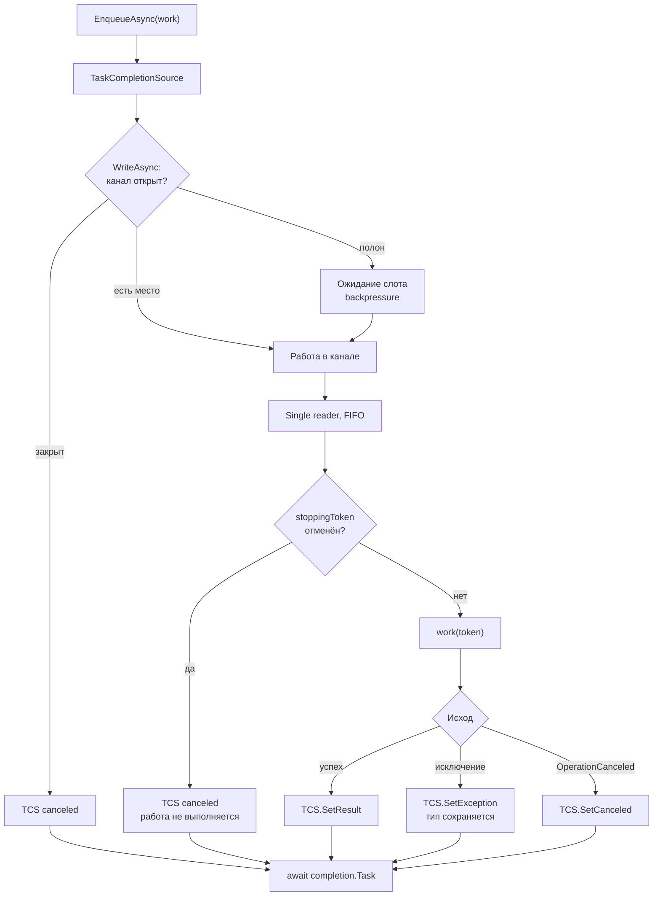

Параметры канала:

```text
Channel.CreateBounded<Func<CancellationToken, Task>>(
    new BoundedChannelOptions(1024)
    {
        SingleReader = true,          // строго один потребитель
        SingleWriter = false,         // писать могут любые вызовы хаба
        FullMode = Wait,              // backpressure, а не потеря работ
        AllowSynchronousContinuations = false,
    });
```

Поведение:

- **Backpressure.** При заполнении канала `WriteAsync` ждёт; вызывающий хаб-метод тоже ждёт. Работы не теряются, но и не накапливаются бесконечно.
- **Закрытый канал.** `ChannelClosedException` → `completion.TrySetCanceled()`, вызывающий получает отмену, а не зависание.
- **Сохранение типа исключения.** `ChatValidationException` доходит до `ChatHub.ExecuteAsync` и превращается в `HubException` с текстом для клиента. Прочие исключения SignalR маскирует общим сообщением.
- **Ошибка одной работы не убивает reader.** Исключение кладётся в TCS, цикл продолжается.

Остановка:

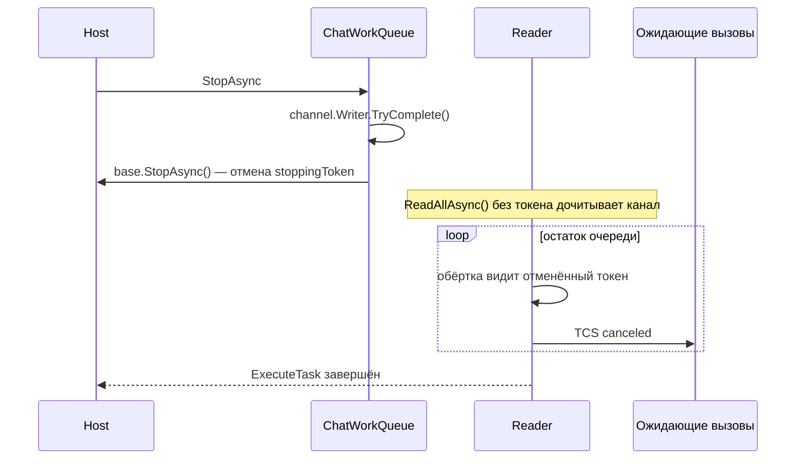

Смысл `ReadAllAsync()` без токена — дочитать очередь, чтобы ожидающие `TaskCompletionSource` завершились отменой, а не зависли. Сами работы при этом уже не выполняются: токен отменён. Поэтому во время shutdown клиентские вызовы получают отмену, а `OnDisconnectedAsync` штатно её перехватывает.

Главное ограничение дизайна: очередь **глобальная**. Все комнаты делят один reader, поэтому медленный broadcast в long-polling-соединении задерживает работы по всем комнатам (head-of-line blocking).

---

## 8. Контракты, сериализация, транспорт

**Контракты и сериализация:**

- DTO в [ChatContracts.cs](../server/SignalRChat.Server/Contracts/ChatContracts.cs) повторяют схемы `openapi/rest.json` и `openapi/signalr.json`; маппинг — [ContractMappings.cs](../server/SignalRChat.Server/Mapping/ContractMappings.cs).
- JSON-протокол SignalR настроен на `camelCase` с нечувствительностью к регистру — совместимо с `generated/rest.ts`.
- `DateTimeOffset` уходит в ISO 8601.
- Hub-методы: `SendMessage`, `JoinRoom`, `SetName`, `LeaveRoom`, `GetHistory`.
- События: `ReceiveMessage`, `UserJoined`, `UserLeft`, `RoomUpdated`; `MessageHistory` объявлено, но не отправляется.
- Имена событий — строковые литералы в двух файлах (`ChatHub` и `ChatRealtimeService`), компилятор их связь с контрактом не проверяет.

**OpenAPI:**

- `SignalR.OpenApi` генерирует документ хаба в рантайме: `/openapi/signalr-v1.json`, Swagger UI — `/signalr-swagger` (значения по умолчанию пакета).
- REST-эндпоинты рантайм-спеки не имеют: `AddOpenApi`/`MapOpenApi` не вызываются, `openapi/rest.json` поддерживается вручную. `Microsoft.AspNetCore.OpenApi` в csproj нужен для пина версии `Microsoft.OpenApi` 1.x, совместимой с `SignalR.OpenApi 1.1.68`.

**Транспорт и хостинг:**

- Разрешён только HTTP long polling: `options.Transports = HttpTransportType.LongPolling`; WebSockets и SSE отклоняются сервером.
- CORS: любой порт на `localhost`/`127.0.0.1`, любые заголовки и методы, `AllowCredentials()` — SignalR-клиент шлёт negotiate с credentials.
- Порт по умолчанию `http://localhost:5000` (`launchSettings.json`); `scripts/dev-all.mjs` выбирает свободный порт динамически.
- В Docker клиент и сервер находятся за одним origin через nginx-прокси `/hubs/` и `/api/`, поэтому CORS в этой схеме не участвует.

---

## 9. Ограничения и риски

1. **Один процесс, память.** Перезапуск теряет всё. Масштабирование требует общего хранилища и SignalR backplane; очередь и группы локальны для инстанса.
2. **Глобальная очередь.** Медленная рассылка блокирует все комнаты; отдельные очереди по комнатам сняли бы head-of-line blocking, но усложнили бы глобальный порядок.
3. **Нет атомарности «мутация + рассылка».** Мутация фиксируется до broadcast; ошибка `SendAsync` даёт клиенту ошибку при уже сохранённом сообщении. Идемпотентного ключа для retry нет — повтор может создать дубль.
4. **`MessageHistory` не отправляется.** Спека обещает событие, сервер отдаёт историю только ответом `GetHistory`. Клиент, полагающийся только на событие, историю не получит.
5. **`RoomUpdated` всем.** Каждое изменение состава комнаты рассылается всем соединениям, включая не состоящие в комнатах. Для демо приемлемо, при росте числа клиентов — шумно.
6. **`LeaveRoom` с чужой комнатой — тихий no-op.** Возвращается `null`, клиент не узнаёт об ошибке.
7. **`SetName` маскируется под `UserJoined`.** Работает благодаря upsert по `id`, но семантика события размыта.
8. **Нет авторизации и лимитов.** Любой `roomId` создаёт комнату; длина сообщения не ограничена; история и число участников не ограничены.
9. **Домен анемичный, `ChatRoom` не используется.** Комната моделируется `RoomState`/`RoomSnapshot` в Application/Infrastructure; доменный тип — мёртвый код.
10. **Чтения мимо очереди.** `GetHistory` может не увидеть сообщение, работа над которым ещё стоит в очереди (staleness, но не порча данных). Гарантии read-your-writes между клиентами нет.
11. **Подключение не даёт пользователя и историю.** Клиент обязан сам вызвать `SetName`/`JoinRoom` и `GetHistory`; список комнат приходит серией событий, а не одним ответом.
